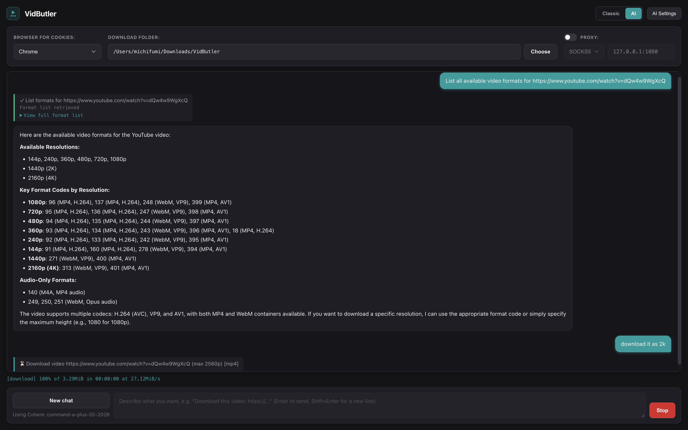

<p align="center">
  
</p>

# VidButler

[English](../README.md)

VidButler is een platformonafhankelijke media-assistent op basis van Electron die werkt met **yt-dlp** en **FFmpeg**. Download video en audio van YouTube, X (Twitter), Instagram en honderden andere websites. Je kunt indelingen kiezen, ondertiteling extraheren, video’s hercoderen en ondertiteling inbranden. De AI-modus kan ook video’s samenvatten op basis van beschikbare ondertiteling en fragmenten uit online bronnen downloaden op basis van de begin- en eindtijd.

Je kunt op elk moment wisselen tussen twee interfaces:

- **Klassieke modus** – Een formulier voor de URL, de gewenste actie en de cookie- en proxyinstellingen.
- **AI-modus** – Beschrijf in gewone taal wat je wilt, bijvoorbeeld *‘Download deze video en brand de Engelse ondertiteling in’*. De app zet je verzoek om in veilige `yt-dlp`- of `FFmpeg`-opdrachten en voert ze uit.

<!--

*Klassieke interface*
-->


*Interface in AI-modus*

Klik op het VidButler-pictogram om **Over VidButler** te openen. Kies bij **Taal** Engels, Duits, Frans, Spaans, Italiaans, Pools, Nederlands, Portugees, vereenvoudigd Chinees, traditioneel Chinees, Japans, Russisch of Oekraïens. **Systeemtaal** volgt de taalvoorkeuren van je besturingssysteem en valt terug op Engels. VidButler onthoudt je keuze na het opnieuw opstarten.

## Functies

- **Twee interfaces** – Wissel op elk moment tussen het klassieke formulier en de AI-chat.
- **Veel ondersteunde platforms** – Download met `yt-dlp` media van YouTube, X, Instagram, TikTok en andere sites.
- **Kwaliteit en indeling** – Kies een resolutie en container of extraheer direct de audio (M4A, MP3, Opus, FLAC, WAV).
- **Ingesloten miniaturen** – De app sluit miniaturen in bij ondersteunde videodownloads. Je kunt de miniatuur ook los opslaan.
- **Ondertiteling** – Download ondertiteling per taal of brand deze boven- of onderaan in het beeld in.
- **Hercoderen naar MP4** – Zet video’s met FFmpeg om naar breed ondersteunde MP4-bestanden met H.264/AAC.
- **Hardwareversnelling** – Gebruikt VideoToolbox op macOS voor het inbranden van ondertiteling en voor ondersteunde MP4-fragmenten.
- **Browsercookies** – Gebruik cookies uit Chrome, Firefox, Brave of Safari om video’s met een leeftijdsbeperking of video’s voor leden te downloaden.
- **HTTP- en SOCKS5-proxy’s** – Leid downloads en verzoeken om via een lokale of externe proxy. Zet **Proxy** aan, kies het type en voer de host en poort in.
- **Annuleren** – Stop een actieve download of codering. Afgebroken downloads kunnen onvolledige bestanden achterlaten in de downloadmap.

## Installatie

De installatiepakketten bevatten yt-dlp, FFmpeg en Deno. Kies `arm64` voor Apple Silicon, Windows op Arm of ARM64 Linux. Kies `x64` voor Intel Macs en de meeste Windows- en Linux-pc’s met Intel of AMD.

### Methode 1 – Homebrew (macOS)

Installeer en werk bij via Homebrew:

```bash
brew install --cask Shawshank01/tap/vidbutler
```

### Methode 2 – Direct downloaden

1. Download de nieuwste versie van de pagina met [releases](https://github.com/Shawshank01/Vidbutler/releases).
2. Voer het installatieprogramma voor je besturingssysteem uit:
   - **macOS:** `.dmg`
   - **Windows:** `.exe`-installatieprogramma
   - **Linux:** `.AppImage`

> [!IMPORTANT]
> De macOS-app heeft een ad-hocondertekening en is niet door Apple genotariseerd. macOS kan een directe installatie vanuit een DMG blokkeren. Homebrew is de aanbevolen installatiemethode. Bij een directe download moet je mogelijk kiezen voor **Open toch** in **Systeeminstellingen > Privacy en beveiliging** of als alternatief `xattr -cr /Applications/VidButler.app` uitvoeren.

### Methode 3 – Vanuit de broncode

De CI-workflows gebruiken Node.js 26 en pnpm 12. Installeer yt-dlp en FFmpeg op je systeem voordat je `pnpm start` uitvoert. Gebruik `brew install yt-dlp ffmpeg` op macOS en `sudo apt install yt-dlp ffmpeg` op Ubuntu of Debian. Voeg de hulpmiddelen op Windows toe aan je `PATH`. Ondertiteling inbranden vereist een FFmpeg-build met het filter `subtitles`, zoals `ffmpeg-full` van Homebrew. Installeer Deno voor [volledige YouTube-ondersteuning](https://github.com/yt-dlp/yt-dlp/wiki/EJS).

1. Kloon de repository:

   ```bash
   git clone https://github.com/Shawshank01/Vidbutler.git
   cd Vidbutler
   ```

2. Installeer de afhankelijkheden:

   ```bash
   pnpm install
   ```

3. Start de toepassing:

   ```bash
   pnpm start
   ```

   *(Op macOS kun je ook dubbelklikken op `start.command` in de hoofdmap van het project om de afhankelijkheden te installeren en de app te starten.)*

#### Installatiepakketten bouwen

Zo maak je een installatieprogramma voor het huidige platform:

```bash
pnpm run build
```

Installatieprogramma’s en uitvoerbare bestanden komen in de map `dist/` terecht.

macOS-releases zijn ad hoc ondertekend en vereisen geen inloggegevens voor het Apple Developer Program. Na een update kan macOS opnieuw om browsertoegang vragen. Windows-builds worden ondertekend als de optionele geheimen `WIN_CSC_LINK` en `WIN_CSC_KEY_PASSWORD` zijn ingesteld.

## Verwijderen

Sluit VidButler af en voer `brew uninstall --cask --zap Shawshank01/tap/vidbutler` uit om de Homebrew-versie en de lokale gegevens te wissen. Kies bij een handmatige installatie **Over VidButler → Lokale gegevens wissen** voordat je de app verwijdert. Hiermee wis je instellingen, opgeslagen API-sleutels en caches van de app. Gedownloade bestanden blijven behouden. Op macOS delen de ontwikkel- en releaseversie deze gegevens. Onderdelen in de macOS-sleutelhanger en caches van losstaande hulpmiddelen of oudere versies van VidButler vallen buiten de opschoning.

## AI-modus gebruiken

Klik rechtsboven op **AI** om het chatpaneel te openen. Vraag in gewone taal om downloads, conversies, bestandsbeheer of analyse van mediabestanden.

### Voorbeeldopdrachten

- *‘Download deze video: https://…’*
- *‘Download deze video in 720p: https://…’*
- *‘Download het fragment van 0:45 tot 2:10: https://…’*
- *‘Download de audio van 1:15 tot 2:30: https://…’*
- *‘Download de audio van deze video als M4A’*
- *‘Vat deze video samen: https://…’*
- *‘In welke talen is er ondertiteling bij deze video?’*, gevolgd door *‘Brand de Engelse ondertiteling bovenaan in’*
- *‘Download de video en hercodeer deze naar een compatibele MP4’*
- *‘Toon de inhoud van mijn downloadmap’* / *‘Verwijder de overgebleven ondertitelingsbestanden’*

Fragmenten downloaden werkt met online bronnen en vereist FFmpeg. Kies bij een proxy **HTTP** en voer het adres in van een HTTP-proxy die CONNECT ondersteunt. Als je proxy alleen SOCKS5 biedt, gebruik dan een lokale HTTP-naar-SOCKS5-bridge. Samenvattingen gebruiken beschikbare ondertiteling en kunnen tijdstempels aanhalen. Voor lange transcripties kunnen meerdere verzoeken aan je AI-aanbieder nodig zijn.

### Een aanbieder instellen

1. Klik rechtsboven op **AI** en open **AI-instellingen**.
2. Kies een aanbieder en controleer het model. Als je aanbieder een API-sleutel gebruikt, plak die dan en klik op **Sleutel opslaan**. Controleer het serveradres bij Ollama of een OpenAI-compatibele server.
3. Klik op **Verbinding testen** en daarna op **Opslaan**.
4. Kies de downloadmap en begin een gesprek.

| Aanbieder | Vereisten | Opmerkingen |
| --- | --- | --- |
| **Cohere** (standaard, model `command-a-plus-05-2026`) | API-sleutel uit het [Cohere-dashboard](https://dashboard.cohere.com/api-keys) | Meest aanbevolen. Het gratis abonnement volstaat voor dagelijks gebruik. |
| **Google Gemini** (model `gemini-3.5-flash-lite`) | API-sleutel uit [Google AI Studio](https://aistudio.google.com/apikey) | Dit model heeft een [gratis abonnement](https://aistudio.google.com/docs/pricing#gemini-3.5-flash-lite). Je berichten gaan naar Google. |
| **xAI Grok** (model `grok-4.3`) | API-sleutel uit de [xAI-console](https://console.x.ai) | Gebruik het om je steun voor de Rockets te tonen. |
| **Ollama (lokaal)** | [Ollama](https://ollama.com) moet actief zijn met een model dat hulpmiddelen kan aanroepen, bijvoorbeeld `lfm3:1.7b`. | Met een lokaal model en een lokale server stuurt de app de chatgegevens naar Ollama op je eigen computer. |
| **OpenAI-compatibel** | Server-URL, modelnaam en meestal een API-sleutel | Werkt met llama.cpp, OpenAI, OpenRouter, Groq, LM Studio en vergelijkbare diensten. |

Kies voor downloads en mediabewerkingen een model dat hulpmiddelen kan aanroepen.

Overige instellingen:

- **Inspanning voor redeneren** – Gemini en xAI bieden eigen instellingen. **Geen** schakelt redeneren uit bij Grok 4.3 en gebruikt bij andere xAI-modellen de standaardinspanning van het model.
- **Bevestigingsniveau** – Kies wanneer de app toestemming vraagt: *Alleen risicovolle acties* (standaard), *Elke actie* of *Nooit*.

Bij een modelverzoek met HTTP 503 probeert de app het meestal één keer opnieuw. Bij HTTP 429 probeert de app het opnieuw als de aanbieder een geldige wachttijd van maximaal 60 seconden in `Retry-After` meegeeft. Controleer bij verificatiefouten de sleutel in **AI-instellingen** en klik op **Verbinding testen**.

### Privacy en beveiliging

- **Gegevens voor de aanbieder** – De app stuurt de chatinhoud en de definities en resultaten van hulpmiddelen naar de gekozen aanbieder. Resultaten kunnen videotitels, ondertiteling, bestandsnamen en het pad naar de downloadmap bevatten.
- **API-sleutels opslaan** – Het instellingenformulier stuurt de sleutel naar het hoofdproces. Opgeslagen sleutels worden lokaal versleuteld met `safeStorage` van Electron. Zonder beveiligde opslag blijven de sleutels tijdens de huidige sessie in het geheugen.
- **Gespreksgeschiedenis** – VidButler bewaart de geschiedenis in het geheugen totdat je een nieuw gesprek start of de app sluit. Externe aanbieders hanteren hun eigen bewaarbeleid voor ontvangen gegevens.
- **Bestandsbewerkingen** – De assistent werkt met media in de gekozen downloadmap. Standaard is bevestiging nodig om bestanden te verwijderen.

## Klassieke modus gebruiken

Voor de klassieke modus heb je geen AI-API-sleutel nodig.

1. Plak de video-URL en kies de doelmap.
2. Kies een actie:
   - **Video downloaden (beste kwaliteit)** – Downloadt de beste beschikbare stream.
   - **Indelingen tonen** – Toont alle beschikbare streams en bijbehorende indelingscodes.
   - **Downloaden (aangepaste indeling)** – Voer een indelingscode in. Gebruik eerst **Indelingen tonen** om de opties te bekijken. Kies een audio-indeling om alleen audio te downloaden.
   - **Miniatuur downloaden** – Slaat alleen de miniatuur op.
   - **Ondertiteling downloaden** – Toont beschikbare ondertitelingssporen en laat je kiezen welke je opslaat.
   - **Downloaden en hercoderen als MP4 van hoge kwaliteit (H.264/AAC)** – Herencodeert met H.264/AAC voor maximale afspeelcompatibiliteit.
   - **Downloaden en ondertiteling inbranden** – Brandt de ondertiteling rechtstreeks boven- of onderaan in de video in.
3. Kies indien nodig een **Browser voor cookies**, bijvoorbeeld voor privévideo’s of video’s met een leeftijdsbeperking, of stel de **Proxy** in.
4. Klik op **Uitvoeren**.

Klik op **Actie annuleren** om een lopende taak te stoppen. VidButler verwijdert onvolledige FFmpeg-uitvoer als je hercodering of het inbranden van ondertiteling annuleert. Afgebroken downloads kunnen onvolledige bestanden achterlaten.

## Updaten

De installatiepakketten voor macOS en Windows en Linux AppImages zoeken bij het starten naar GitHub-releases.

1. Kies op **Windows en Linux AppImage** voor **Downloaden en opnieuw starten**. De controlesom wordt geverifieerd, de update wordt geïnstalleerd en de nieuwe versie start automatisch.
2. Kies op **macOS** voor **Homebrew-opdracht kopiëren**. Plak de opdracht in Terminal om de tap te vernieuwen en de update te installeren.

   ```bash
   brew update --force && brew upgrade --cask Shawshank01/tap/vidbutler
   ```

   Als je VidButler direct vanuit een DMG hebt geïnstalleerd, kies je **Versie op GitHub openen**.
3. Wil je handmatig controleren, klik dan op het VidButler-pictogram en kies **Controleren op updates**.

> [!NOTE]
> Als je de app vanuit de broncode of een uitgepakt Linux-pakket draait, kun je met **Controleren op updates** de [nieuwste release](https://github.com/Shawshank01/Vidbutler/releases/latest) openen.

## Gebruikte projecten

- [yt-dlp](https://github.com/yt-dlp/yt-dlp) – De kern van het downloaden van media
- [FFmpeg](https://ffmpeg.org/) – Audio- en videoverwerking, transcodering en het inbranden van ondertiteling
- [Deno](https://deno.com/) – Lichtgewicht JavaScript-runtime voor het oplossen van yt-dlp-uitdagingen
- [Electron](https://www.electronjs.org/) – Framework voor desktoptoepassingen
